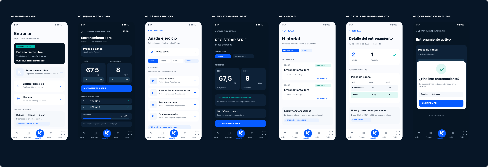
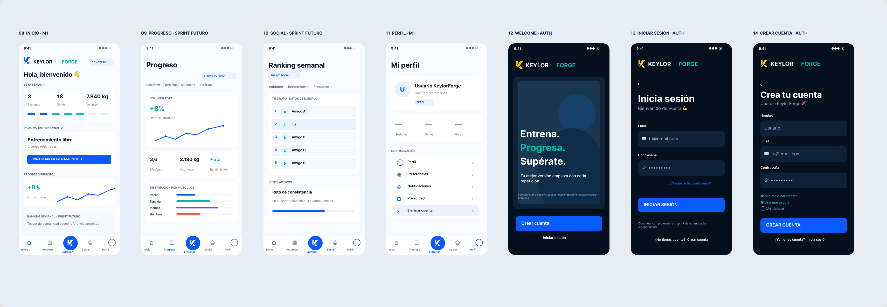
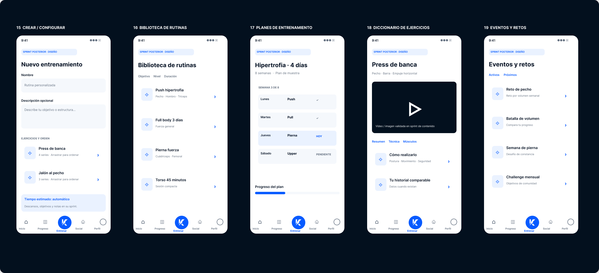

# KeylorForge — UX/UI v2 (M3 reference boards)

**Status:** design proposal visually accepted in conversation; reference assets for review and implementation planning, **not** an implementation of any new functionality.

**Editable design:** [Open the Figma v2 source](https://www.figma.com/design/siS159Erdj9OZcejWOiGyd)

**Product owner-approved visual baseline:** [original approved product board](../keylorforge-ui-reference/keylorforge-ui-foundation-v1.png), [original M1 reference](../keylorforge-ui-reference/keylorforge-m1-reference-v1.png), [original auth reference](../keylorforge-ui-reference/keylorforge-auth-reference-v1.png) and [visual implementation contract](../KEYLORFORGE_VISUAL_FOUNDATION.md).

> The original illustrations may still show the historical *KeylorFit* wordmark; the live app and these new mockups use **KeylorForge**, with the real G4 symbol taken from `brand/`.

## Board 1 — M3: workout experience

Individual screens (390 × 820 px exports):

1. [Training Hub](m3/01-training-hub.png)
2. [Active workout — dark immersive mode](m3/02-active-workout-dark.png)
3. [Choose exercise / catalogue](m3/03-exercise-catalog.png)
4. [Register a set — dark immersive mode](m3/04-register-set-dark.png)
5. [Workout history](m3/05-workout-history.png)
6. [Workout details](m3/06-workout-detail.png)
7. [Finish confirmation](m3/07-finish-confirmation.png)

M3's tested engine, local SQLite persistence, FastAPI transport, synchronization, workout history and Android QA should remain intact. Extra mechanisms **not already implemented** (rest timer UI, advanced RIR/RPE, persistent notes/editing, predictive search) are *future-sprint concepts*, not claims of availability.

## Board 2 — Existing shell / visual continuity

8. [Home](shell/08-home.png)
9. [Progress — concept for later sprint](shell/09-progress-future.png)
10. [Social — concept for later sprint](shell/10-social-future.png)
11. [Profile](shell/11-profile.png)
12. [Welcome — dark auth direction](shell/12-welcome-auth.png)
13. [Sign in — dark auth direction](shell/13-sign-in-auth.png)
14. [Sign up — dark auth direction](shell/14-sign-up-auth.png)

Navigation must retain **Inicio · Progreso · Entrenar · Social · Perfil**, with a prominent central training action. The actual brand assets live under [`/brand`](../../../brand/) and `apps/mobile/assets/brand/`. **Welcome photography has not yet been imported into Figma v2:** its existing canonical asset is `apps/mobile/assets/images/welcome-hero.png`; do not treat the abstract placeholder as an approved substitute.

Metrics and sample ranking names shown in the mockups are illustrative **design data, not live user information**. Do not insert fake values into production.

## Board 3 — Future functionality (separate sprints)

15. [Create / configure workout](future/15-create-configure.png)
16. [Workout library](future/16-workout-library.png)
17. [Training plans](future/17-training-plans.png)
18. [Exercise dictionary](future/18-exercise-dictionary.png)
19. [Events and challenges](future/19-events-challenges.png)

These screens are **visual-only proposals**. Plans, routines, recommendations, social/rankings, progress analytics, enriched exercise content and events require separately scoped development sprints.

## Review and implementation rules

- Compare the visual treatment against the three original approved images and the [product visual foundation](../KEYLORFORGE_VISUAL_FOUNDATION.md).
- **Standard mode is light**; **active workout is dark and distraction-minimizing**; auth preserves its separate dark photographic direction.
- The Figma file is the **editable source**. GitHub PNGs are **versioned previews/reference evidence**, not interactive implementations.
- Keep the existing production naming **KeylorForge** and the original G4 mark; no generic letter-logo substitutions.
- Only implement the already supported M3 features during the M3 UX visual sprint. Each additional capability gets its own sprint/contract/QA.
- Preserve offline-first behavior, session history, SQLite outbox, security and previously approved physical-device test results. Do not reset or uninstall the Android QA application to check visual changes.
- Approval and progress tracked in [issue #169](https://github.com/Limman-qaidev/keylorforge/issues/169).

**Captured:** 2026-10-22 from the editable Figma design. All images are native PNG snapshots that GitHub can preview directly. 
